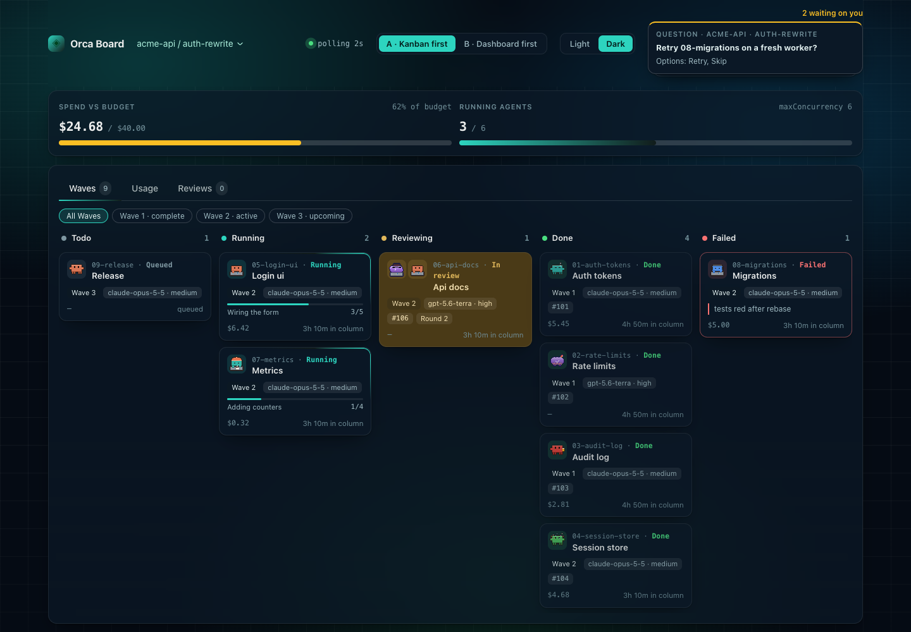
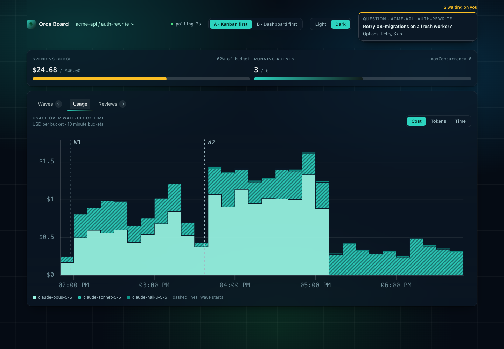

# complexthings/skills

Two Claude Code plugins from [Complex Things](https://github.com/complexthings):
**`orca-helpers`**, which turns a rough idea into a planned, orchestratable
workstream, and **`adhd-friendly`**, which keeps Claude's replies short and
actionable.

This repository is generated. It is the install target only — source, issues, and
pull requests live in the private build repo. Every publish replaces the entire
history with a single commit, so clone it fresh rather than pulling.

## Install

From your shell:

```bash
claude plugin marketplace add complexthings/skills
claude plugin install orca-helpers@complexthings
claude plugin install adhd-friendly@complexthings
```

Or from inside a Claude Code session:

```
/plugin marketplace add complexthings/skills
/plugin install orca-helpers@complexthings
/plugin install adhd-friendly@complexthings
```

Install only the one you want — the two plugins are independent.

Standalone skills are not part of either plugin and install separately. See
[Standalone skills](#standalone-skills).

---

## `orca-helpers`

Run **`/orca-prompt`** to plan an [Orca](https://orca.computer) Workstream,
then **`/orca-execute <workstream>`** to run it.

A Workstream is a named body of work: one plan, one set of Work Items grouped
into Waves, and one target branch. Writing one by hand is the slow part. You
decide how the work splits, which Agent Harness runs each piece and which model
each slot uses. orca-helpers asks you those questions, writes the files, runs
them and shows the progress above the prompt.


It needs Claude Code v2.1.287 or later (v2.1.286 in the Desktop app), Python 3
and the `orca` CLI.

### Using it

1. Run `/orca-prompt-settings` once per repo to store your defaults. This step is optional.
2. Run `/orca-prompt` and answer the interview. It writes `.orca/prompts/<workstream>/`.
3. Run `/orca-execute <workstream>` to run it now, or `/orca-prompt-scheduler` to run it later.
4. Watch the Wave Band until its Done tab opens.
5. Run `/orca-board` to see every Workstream across repos in a browser.

### Skills

Plan and run:

- `orca-prompt` interviews you in five rounds: Basics, Harness, Models, Timing and Scope. Then it writes `_config.json`, `_plan.md`, one prompt per Work Item and `_orchestration.prompt.md`.
- `orca-execute` runs a Workstream Wave by Wave as its Main Orchestrator. You start it by typing the command.
- `orca-prepare` readies a running Workstream for compaction or handover, and prints the `/orca-execute` line that resumes it.
- `orca-prompt-settings` stores repo defaults: Agent Harnesses, Model Slots, concurrency and Priority File.
- `orca-prompt-scheduler` schedules a Workstream as a one-shot Orca automation that fires exactly once.

Watch and remember:

- `orca-board` opens the Board, a local page for every Workstream across repos.
- `orca-pr-review` runs a loop in your session that reviews other people's PRs in the repos you watch.
- `orca-bootstrap` creates the repo's Orca Knowledge Graph under `~/.claude` and backfills it from every Decision Log.
- `orca-kb` recalls facts from that graph for a task, writes new ones, and lints it.

Every skill writes to you by one Communication Standard: the next action first,
short plain sentences, and one next step at the end.

### Planning with `orca-prompt`

Each question marks one answer (Recommended), so you accept a good default in
one click. The scope round uses `grill-with-docs` from Matt Pocock's
[`mattpocock-skills`](https://github.com/mattpocock/skills) when it is
installed, and its own built-in grilling otherwise.

Before validate, the Prompt Check reads the new Workstream cold. `check_paths.py`
flags every missing path, and three Goldfish Readers report what a worker could
not act on. A Workstream runs or is scheduled only after a clean validate.

### Running with `orca-execute`

The session that runs `/orca-execute <workstream>` becomes the Main
Orchestrator. It starts one Orchestration Worker per Work Item, merges each PR,
and starts the next Wave once the last one is merged.

- Before a Work Item merges, a reviewer from a different Agent Harness signs SHIP or NO-SHIP on its diff. Only a finding with a Demonstrated Failure blocks.
- On NO-SHIP, a fresh worker fixes the findings in the author's worktree. The third NO-SHIP fails the Work Item and asks you how to go on.
- Each Workstream keeps a Decision Log in `_decisions.md`, with a Wave Retro after each Wave.
- Run `/orca-prepare` before a compaction. Then `/orca-execute <workstream>` in any session resumes the run where it stopped.
- `/orca-execute stop` hides the band, and `/orca-execute copy` copies the run as Markdown.

### The bands

The Prompt Band follows the `orca-prompt` interview. It walks the five steps,
keeps every answer in view under one Harness Avatar per Agent Harness, and
draws a one-row step strip above each question. Its Ready tab shows the Work
Items per Wave and the next command to run.


The Wave Band follows a run. It shows up to 4 Wave slots and the current Wave's
Work Items under TODO, In Progress and Complete. An In Progress card draws a
progress bar and the worker's latest note.

- Press **`o`** on a focused band, or click its caret, to collapse it.
- Press **`b`** to open the Board, and **`c`** to copy the run as Markdown.
- Once every Work Item is merged, the Done tab shows the run time and the PRs merged.


### The Board

Run **`/orca-board`** to open a local page for every Workstream across repos.

- A sidebar lists each repo with a Wave progress bar and an attention count. On a phone it turns into a repo dropdown.
- The Status Page opens first, with a Needs attention strip, a usage chart and a Spend panel.
- Each repo's page has three tabs. Waves shows a swimlane per Workstream, Reviews lists `orca-pr-review` PRs, and Config edits the repo's settings.
- A held Review Draft opens in a modal with Publish Review and Adjust Review.
- Every save goes through the plugin script that owns the file, behind a per-server token.





### orca-pr-review

Run **`/orca-pr-review start`** to pick the repos to watch. The loop then scans
them on a session cron. It claims a PR that requests your review only when
nobody is assigned, and reviews it with an Orca review worker.

In manual mode the Review Draft waits for `/orca-pr-review approve <owner/repo#n>`.
In auto mode it posts on the next tick. Run
`/orca-pr-review feedback <owner/repo#n> <text>` to have the worker rewrite a
held draft. Review Settings live outside every repo, so nothing lands in a
teammate's codebase.

### Ambient signals

During a run, a toast reports each Wave complete, each failed Work Item and the
final merge. A status line entry and a Spinner word show the current Wave and
its count. Bands and signals draw only in the Owning Session, the session that
started the interview or the run.

### Pictures in an Orca terminal

Run **`/orca-images`** once, then restart Claude. It adds this line to
`~/.zshrc` or `~/.bashrc`:

```bash
[[ $TERM_PROGRAM == Orca ]] && export CLAUDE_CODE_FORCE_TERMINAL_IMAGES=1
```

Claude Code draws the band pictures in an Orca terminal only when
`CLAUDE_CODE_FORCE_TERMINAL_IMAGES=1` is set. Orca sets it only for agents it
launches. Without it, the bands fall back to half-block text art, and a toast
names the fix.


The plugin's own [`README.md`](orca-helpers/README.md) covers every detail.

---

## `adhd-friendly`

Keeps Claude's replies short, actionable, and consistently shaped.

Long, meandering replies are hard to act on — the next step gets buried three
paragraphs down, and by the time you have found it you have lost the thread. This
plugin fixes the shape of the reply rather than asking you to re-read it.

Three hooks and one output style:

- A **Reply Card** prints beside every prompt, sized to that prompt. A one-line
  question gets a one-line card.
- A **Reply Meter** silently scores each finished reply and logs the result, so
  the next card can call out what slipped.
- A **session card** prints at most three lines saying where the last session
  left off.

The long rules ship as a bundled output style, loaded once per session, so the
per-turn cost stays small.

It also ships one skill:

- **`/adhd-stats`** — the scoreboard: violation trend, reply length, card tier
  distribution, and the modelled token saving.

Three optional knobs (card tier thresholds, meter on/off, strictness) are
documented in the plugin's own `README.md`. The defaults need no configuration.

---

## Standalone skills

Skills that belong to no plugin. They live under `skills/` and are not declared
in the marketplace manifest, so `claude plugin install` does not reach them.
Install one directly:

```bash
npx skills@latest add complexthings/skills --skill pi-init --agent claude-code -y
```

That installs into `./.claude/skills/pi-init/`. In an open Claude Code session,
run `/reload-skills` afterwards to pick it up.

- **`/pi-init`** — writes or updates a concise, evidence-backed root `AGENTS.md`
  for the current project. Manually invoked only.

## Layout

```
.claude-plugin/marketplace.json          plugin manifest
orca-helpers/skills/<skill>/SKILL.md     orca-helpers skill entry points
adhd-friendly/skills/<skill>/SKILL.md    adhd-friendly skill entry points
skills/<skill>/SKILL.md                  standalone skills, not in the manifest
```

## License

See the repository owner for licensing.
