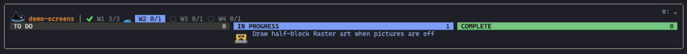
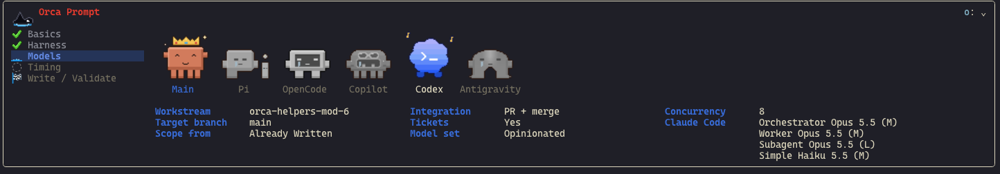
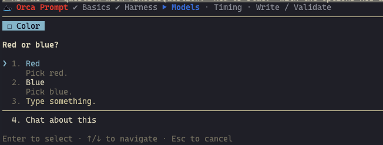
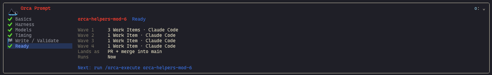
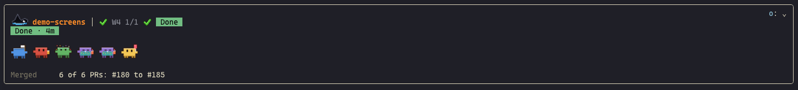
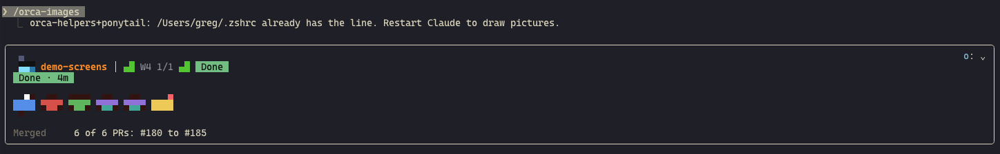

# orca-helpers

Plans, runs and tracks [Orca](https://orca.computer) Workstreams from inside
Claude Code. A **Workstream** is a named body of work: one plan, one set of Work
Items grouped into Waves, one target branch. Everything for one Workstream lives
under `.orca/prompts/<workstream>/`.

orca-helpers is a Claude Code mod: four skills plus a hooks module. The skills
interview you, write the Workstream, run it and schedule it. The hooks module
draws two bands above the prompt that show where the interview and the run
stand, and it guards the files those bands read.



## Requirements

- Claude Code **v2.1.287 or later** in the terminal (v2.1.286 in the Desktop app). Older versions load the skills but not the bands or the hooks.
- Python 3 on `PATH`, for the skill scripts.
- The `orca` CLI, for dispatch and scheduling.

## Install

```bash
claude plugin marketplace add complexthings/skills
claude plugin install orca-helpers@complexthings
```

Run `/reload-plugins` in any session that was already open. Inside an Orca
terminal, also run `/orca-images` once. See [Pictures in an Orca terminal](#pictures-in-an-orca-terminal).

## Use it

1. Run `/orca-prompt-settings` once per repo to store your Agent Harnesses, models and concurrency. This step is optional.
2. Run `/orca-prompt` and answer the interview. It writes `.orca/prompts/<workstream>/`.
3. Run `/orca-execute <workstream>` to run it now, or `/orca-prompt-scheduler` to run it later.
4. Watch the Wave Band. It ends on the Done tab once every Work Item is merged.

## Skills

- **`orca-prompt`** interviews you in a fixed order: Basics, Harness, Models, Timing, then the scope. It writes `_config.json`, `_plan.md`, one prompt per Work Item and `_orchestration.prompt.md`. It asks how results integrate (commit, branch, PR, or PR + merge) and settles the Definition of Done. It asks one effort per Model Slot. It schedules a Workstream only after a clean validate.
- **`orca-execute`** runs a Workstream Wave by Wave as its Main Orchestrator. `/orca-execute <workstream>` starts or resumes it, and `/orca-execute stop` hides the band. Claude never starts it on its own: you type the command.
- **`orca-prompt-settings`** stores the repo-level defaults in `.orca/prompts/prompt-settings.json`: Agent Harnesses, Model Slots, Main Orchestrator harness, target branch, concurrency and Priority File. `orca-prompt` then stops asking for them.
- **`orca-prompt-scheduler`** schedules a Workstream's `_orchestration.prompt.md` as a one-shot Orca automation. A Once-Guard makes it fire exactly once.

`orca-prompt` settles the Scope of Work with `grill-with-docs` from Matt Pocock's
[`mattpocock-skills`](https://github.com/mattpocock/skills) when it can. When
that skill is missing or refuses model invocation, `orca-prompt` runs its own
built-in grilling procedure, so the plugin works without it.

## The Prompt Band

While `orca-prompt` interviews you, a band above the prompt follows along.
`set_prompt_band.py` records every step and answer in
`.orca/prompts/_prompt-band.json`, and the band polls that file every 2 seconds.



- The left column walks the five steps under the orca: Basics, Harness, Models, Timing, and Write / Validate. Done steps show a checkmark, the current one an animated wave, later ones an upcoming mark.
- The right side keeps every answer in view, under one Harness Avatar per detected Agent Harness. A crown marks the harness that runs the Main Orchestrator. On Write / Validate a checklist ticks while that avatar types.
- Click a done step to pin it. While an interview is live, the Prompt Band takes the Wave Band's place.
- A one-row step strip draws above each question dialog, so the interview stays in view while you answer.



### The Ready tab

At `end` a sixth tab, Ready, opens by itself. It reads the Workstream's
`_config.json` and shows the Work Items per Wave with their Agent Harnesses, how
the work lands in the target branch, and the next command to run. `end` hands
the band's place back to the Wave Band at the next poll. A finished Prompt Band
stays hidden until startup or `/clear`.



## The Wave Band

While a Workstream is active, a band above the prompt shows its progress.
`orca-execute` marks a Workstream active, and `set_status.py` records every Work
Item state in `.orca/prompts/<workstream>/_status.json`. The band polls those
files every 2 seconds, so it comes back after `/resume` or in a new session.

- The top bar shows an animated orca, the Workstream name, up to 4 Wave slots with `(complete/total)` counts, and a `+N More Waves` slot when more remain.
- The body lists the current Wave's Work Items under TODO, In Progress and Complete, each with its Harness Avatar. A failed item stays in In Progress in red, with its reason.
- Click a Wave slot to pin that Wave.
- Click the caret, or focus the band with Ctrl+X then Tab and press **`o`**, to collapse the band to its top bar. Both bands share this toggle.

### The Done tab

Once every Work Item is complete, a Done tab follows the last Wave and opens by
itself. Its card shows the run time, every Harness Avatar, and the PRs merged.



## Ambient signals

While a Workstream runs, three signals report progress outside the band:

- A **toast** on each Wave complete (`Wave 2 complete: 3 PRs merged`), on each failed Work Item with its reason, and once all Waves are merged.
- A **status line entry** such as `orca my-workstream W2 2/4 · 1 failed`. It clears once `set_status.py --stop` ends the run.
- A **Spinner word** such as `Wave 2 · 2/4 merged`, shown while Claude works.

Bands and ambient signals draw only in the **Owning Session**: the session that
last ran `set_prompt_band.py begin` or `set_status.py --start`. Other open
sessions on the same repo stay quiet.

## Pictures in an Orca terminal

The bands draw their icons and Harness Avatars as pictures. Claude Code draws
pictures in an Orca terminal only when `CLAUDE_CODE_FORCE_TERMINAL_IMAGES=1` is
set. Orca sets it only when Orca itself launches Claude as an agent. When you
type `claude` in a plain Orca terminal, the variable is missing.

With pictures off, the bands draw each icon and Harness Avatar as half-block
text art at the same size. A toast shows once per session and names the fix.

Run **`/orca-images`** to fix it for good. It appends this line to `~/.zshrc`
for zsh or `~/.bashrc` for bash, under a one-line comment:

```bash
[[ $TERM_PROGRAM == Orca ]] && export CLAUDE_CODE_FORCE_TERMINAL_IMAGES=1
```

It skips the write when the line is already there. For any other shell it
prints the line for you to add. Restart Claude afterwards: Claude Code checks
for picture support before the mod loads.



The Desktop app needs none of this. It draws the same pixels as SVG.

## Hooks

- **`_status.json` and `_prompt-band.json` guard** denies Edit and Write on any `_status.json` under `.orca/prompts/` and on `.orca/prompts/_prompt-band.json`. It tells Claude to run `set_status.py` or `set_prompt_band.py` instead. Both scripts write atomically, so a band never reads half a file.
- **Stale settings warning** prints one line at session start when `.orca/prompts/prompt-settings.json` names a model its Priority File does not rank.

The Harness Avatars cover Claude Code, GitHub Copilot, OpenCode, Codex, Pi and Antigravity.

## Changes in 0.6.3

- A failed Work Item stays in the In Progress lane, drawn red with its reason, instead of a row above the columns.

## Changes in 0.6.2

- The Wave Band shows however the `set_status.py --start` command reads, shell variables included. The scripts now record the Owning Session themselves.
- Work Items in one Wave never share an avatar color, up to seven per Wave. The colors still change from Wave to Wave.

## Changes in 0.6.1

- Bands draw in a plain Orca terminal. With pictures off, the Prompt Band, the step strip and the Wave Band draw half-block Raster art instead of alt text.
- A toast shows once per session when pictures are off, and `/orca-images` adds the `CLAUDE_CODE_FORCE_TERMINAL_IMAGES` export to `~/.zshrc` or `~/.bashrc`.
- A chained `set_prompt_band.py begin` or `set_status.py --start` command now claims the band.
- The Prompt Band shows no gap above the Harness Avatars, and each Model Slot sits on its own untruncated line.
- The Wave Band header draws on one row.
- READMEs for the plugin, the skills-build repo and the published skills repo, with screenshots.

## Changes in 0.6.0

- The Wave Band takes the refined-columns layout, with a header rule that draws as one line on Desktop and Harness Avatars large enough to read in the TUI.
- The Prompt Band is a stepper, and a one-row step strip inside the question dialog keeps the interview in view.
- The Prompt Band ends on a Ready tab and the Wave Band ends on a Done tab, each with a summary card.
- A toast on Wave complete, item failed and all merged, plus a status line entry and a Spinner word.
- Bands and ambient signals draw only in the Owning Session, the session that last ran `set_prompt_band.py begin` or `set_status.py --start`.
- `_status.json` records each Work Item's `pr`, `startedAt` and `finishedAt`.
- Fixes from five code-review rounds over the whole plugin.

## Changes in 0.5.1

- Codex Harness Avatars are the logo cloud with two feet, in all 48 strips and states.
- Pi Complete strips keep the `i` at its Todo and In Progress height.
- The Prompt Band shows during an orca-prompt interview while a Workstream is active, and the Wave Band returns at `end`.
- Band pictures draw in the Orca terminal again, and each Wave Band Work Item shows its Harness Avatar.
- Fixes from five code-review rounds over the whole plugin.

## Changes in 0.5.0

- Added the Wave Band Harness Avatars: Todo, In Progress and Complete for all six Agent Harnesses, in seven Avatar Moods, at 18x18 and 24x24.
- The Wave Band uses the Mod Part 2 icons and shows each Work Item's Harness Avatar. Only one band draws at a time, and both share one collapse toggle.
- orca-prompt ranks the new model set and discovers Copilot models.
- Final review fixes: Copilot is the helmet head from its logo, every Complete keeps its harness's body proportions, Codex is back to its original design, and Antigravity carries its logo gradient.

## Changes in 0.4.0

- Added the Prompt Band, the picked step icons, the animated orca and the six Harness Avatars.
- Removed the separate prime harness role. The Main Orchestrator settings cover it.
- Removed the reasoning-level question and `reasoningLevel`. Each Model Slot now carries its own effort, and old Prompt Settings still read: `reasoningLevel` is ignored.
- Timing moved to Round 4, before the scope interview.
